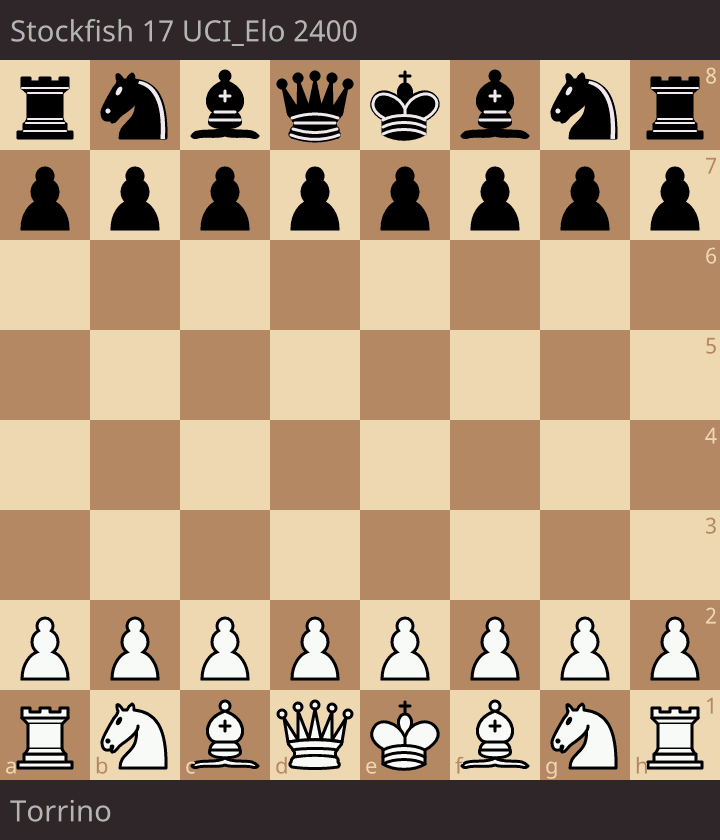
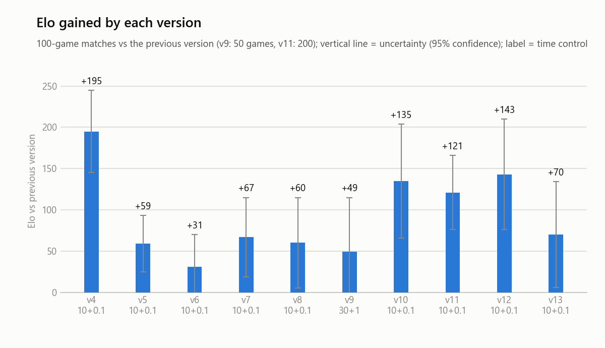
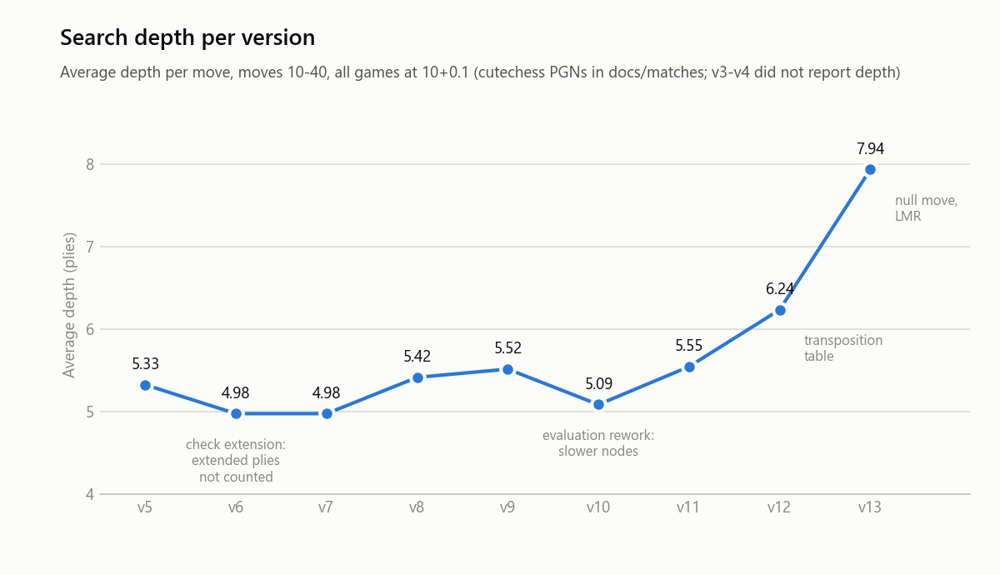
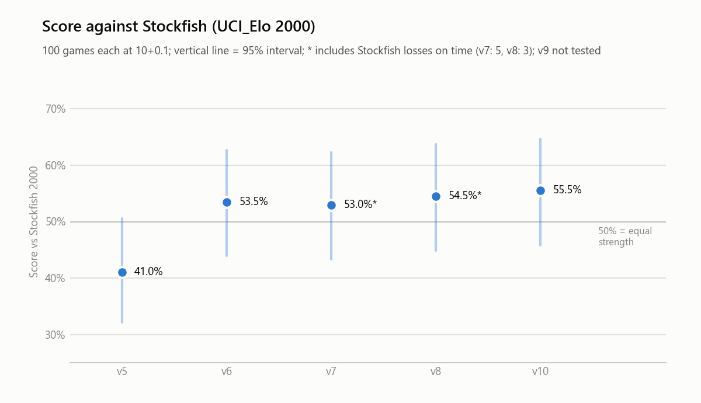
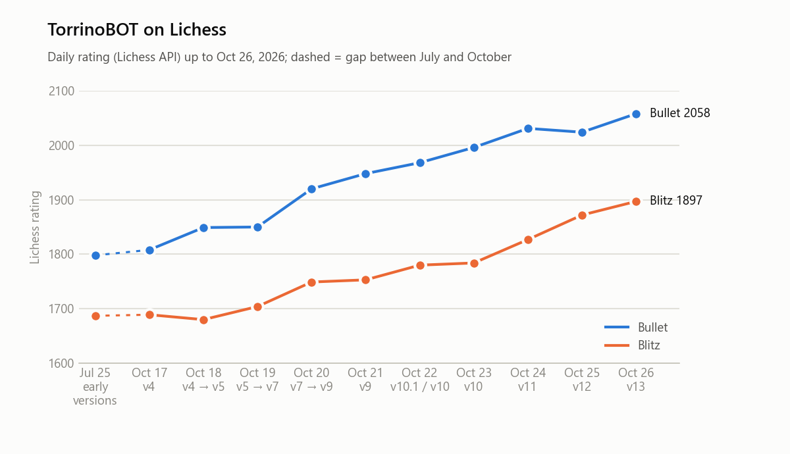
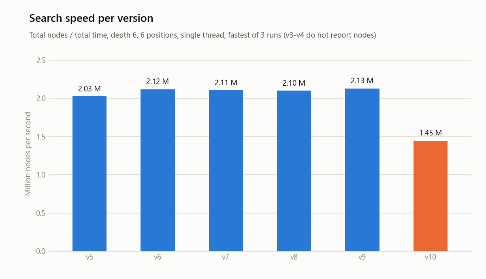
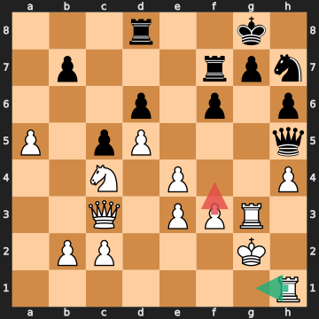
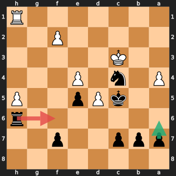
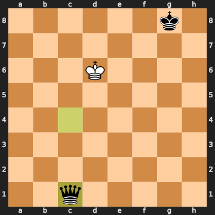

# Torrino

**A UCI chess engine written from scratch in C++17: bitboards, alpha-beta search and a hand-crafted tapered evaluation, developed and measured version by version (≈ Stockfish `UCI_Elo` 2000 at 10+0.1).**


<!-- TODO: add a license badge once LICENSE exists, e.g.  -->

<!-- HERO GIF: must be the GIF of a whole GAME (animated), not of a single position.
     On the Lichess game page: "Share & export" -> GIF, or https://lichess1.org/game/export/gif/<GAME_ID>.gif
     Save it as docs/gifs/hero.gif (replacing the current static image). -->
<p align="center"></p>

Torrino plays online as **[TorrinoBOT](https://lichess.org/@/TorrinoBOT)** (bullet 1963, blitz 1751 as of October 22, 2026).
Every change is first verified for correctness and then measured in engine-vs-engine matches;
the complete log of changes and results is in **[VERSIONS.md](VERSIONS.md)**.

---

## Highlights

- **Measured, incremental development.** Each version was tested in a 100-game match against the previous one
  (cutechess-cli, balanced openings, colours swapped). The latest step, **v10 vs v9: +135 ± 69 Elo**
  (95% confidence interval; 62 wins, 25 losses, 13 draws).
- **Correctness by construction.** Move generation matches the reference **perft** counts on the 6 standard test
  positions; every evaluation change is checked for colour symmetry; speed optimisations are checked to leave the
  search unchanged (identical node counts at fixed depth).
- **Evaluation driven by real games.** Weaknesses found in Lichess games (king safety, passed pawns, unconverted
  endgames) were reproduced as test positions, fixed and re-measured: v10 gained **+135 Elo** over v9 while searching
  *less* deep (5.2 vs 5.5 plies on average).
- **Strength against an external reference:** 55.5% (+38 ± 67 Elo) against Stockfish limited to `UCI_Elo` 2000
  in 100 games at 10+0.1.

---

## Table of contents

1. [Quick start](#quick-start)
2. [Architecture](#architecture)
3. [How the engine works](#how-the-engine-works)
4. [Version history](#version-history)
5. [Results](#results)
6. [Testing and validation](#testing-and-validation)
7. [Case studies](#case-studies)
8. [Limitations and future work](#limitations-and-future-work)
9. [What I learned](#what-i-learned)
10. [About](#about)
11. [References](#references)

---

## Quick start

Requirements: a C++17 compiler (developed with g++ / MinGW-w64 on Windows).

```bash
git clone https://github.com/GiorgioPaoli/torrino.git
cd torrino/src
g++ -O3 -march=native -flto -static -std=c++17 *.cpp -o ../bin/torrino.exe
../bin/torrino.exe
```
<!-- TODO: replace with a Makefile or CMakeLists.txt so the build is one command, and test it on a clean machine. -->

Example UCI session (input lines, then the engine's output):
```text
uci
position startpos moves e2e4 e7e5
go movetime 2000
info depth 7 score cp 35 nodes 2847000 nps 1300000 time 2190 pv e2e4
bestmove ...
```
Extra commands: `go depth N`, `eval` (static evaluation and game phase of the current position).
Works with any UCI (Universal Chess Interface) GUI, such as cutechess, En Croissant or Arena, and with
[lichess-bot](https://github.com/lichess-bot-devs/lichess-bot).

---

## Architecture

| Module | Files | Role |
|---|---|---|
| Board representation | [`board`](src/board.cpp), [`types.h`](src/types.h), [`bitboard.h`](src/bitboard.h) | bitboards + mailbox; `makeMove`/`unmakeMove`; Zobrist key and position history |
| Attack tables | [`attacks`](src/attacks.cpp) | precomputed pawn/knight/king attacks; sliding-piece attacks (ray loops) |
| Move generation | [`movegen`](src/movegen.cpp) | pseudo-legal generation, legality check, move ordering (MVV-LVA, killers) |
| Search | [`search`](src/search.cpp) | negamax alpha-beta, quiescence, iterative deepening, time management |
| Evaluation | [`eval`](src/eval.cpp) | tapered piece-square tables, king safety, pawn structure, mop-up |
| Protocol | [`uci`](src/uci.cpp) | UCI loop, time-control parsing, `info` output |
| Testing | [`perft`](src/perft.cpp), [`tools/`](tools/) | perft; scripts for PGN statistics, charts and board diagrams |

---

## How the engine works

### Board representation and move generation
The board is stored as 12 bitboards (one 64-bit integer per piece type and colour) plus a 64-square mailbox.
Bitboards turn attack detection and pawn-structure analysis into a few bitwise operations. Moves are generated
pseudo-legally and then checked for legality; `makeMove`/`unmakeMove` update the position incrementally, without
copying the board. Move generation matches the reference perft counts on all 6 standard positions and runs at
about 7-8 M nodes/s in perft (single thread). Sliding-piece attacks still use ray loops, which is the main speed
bottleneck (see [Limitations](#limitations-and-future-work)).

### Search

| Technique | What it does | Measured effect |
|---|---|---|
| Alpha-beta (negamax) + iterative deepening | prunes branches that cannot change the result; reuses the previous best move | baseline (v2-v3) |
| **Quiescence search** | at the horizon, keeps searching captures until the position is quiet (stand-pat) | **+195 ± 50 Elo** (v4 vs v3) |
| **Killer moves** | tries first the quiet moves that caused a cutoff at the same ply | **+59 ± 34 Elo**; 3.8× fewer nodes at fixed depth on 6 test positions (21× in the start position) |
| Check extension + mate scores | searches one ply deeper when in check; reports `mate N` | +31 ± 39 Elo (not significant at 95%, LOS 94%) |
| **Zobrist hashing + repetition detection** | 64-bit incremental position keys; a repeated position scores as a draw | **+67 ± 48 Elo**; draw rate vs the previous version 67% → 51% |

Elo figures are from 100-game matches against the previous version, with 95% confidence intervals;
LOS is the likelihood of superiority.

### Time management
The engine computes a *soft* limit (ideal time per move) and a *hard* limit (deadline), estimates the cost of the next
depth from the previous iterations, and does not start a depth it cannot finish. When the deadline interrupts a
depth, the best move found so far is kept. Measured gains: +60 ± 55 Elo (v8) and +49 ± 66 Elo (v9, not significant at 95%);
the first attempt at v9 was too conservative and ended 30+1 games with more time than at the start
(found by extracting thinking times from the game records, see [VERSIONS.md](VERSIONS.md)).

### Evaluation
The evaluation was rebuilt in v10 in three steps, each targeting a weakness found in real games and each tested
against the previous step:

- **v10.1 - Tapered evaluation and mop-up (+123 ± 59 Elo).** Middlegame and endgame scores are blended according
  to the game phase (computed from the remaining pieces); in the endgame the king is centralised and, with a clear
  material advantage, the losing king is driven to the corner. Before this, basic endgames such as KR vs K were drawn
  by the fifty-move rule.
- **v10.2 - King safety (+53 ± 60 Elo, LOS 95.8%).** Castling rights, pawn shield, exposed king, and enemy pieces
  attacking the squares around the king, in the middlegame only. Before this, the engine opened its own king
  ([case study 1](#case-studies)).
- **v10.3 - Pawn structure (+100 ± 65 Elo).** Passed pawns (bonus growing with the rank, larger in the endgame),
  isolated, defended and doubled pawns. Before this, passed pawns were ignored ([case study 2](#case-studies)).

**v10 vs v9 in a direct match: +135 ± 69 Elo.** The sum of the three steps (+276) overestimates the total, because
gains measured against the immediately previous version do not add up linearly; the direct match is the reported figure.

---

## Version history

The engine was built in small steps, and every step is a tagged version in the repository. The table summarises what
each version added and what it gained in a 100-game match against the previous one (95% interval; the full test
logs are in [VERSIONS.md](VERSIONS.md)).

| Version | What it added | Elo vs previous |
|---|---|---|
| v1, v1.5 | First working engine: board, move generation, basic search <!-- TODO: check what v1 and v1.5 contain --> | - |
| v2 | Alpha-beta pruning | - |
| v3 | Iterative deepening (search depth 1, 2, 3... instead of one fixed depth) | - |
| v4 | Quiescence search, development terms in the evaluation, en passant fix | +195 ± 50 |
| v5 | Killer-move ordering | +59 ± 34 |
| v6 | Check extension and mate scores (`score mate N`) | +31 ± 39 |
| v7 | Zobrist hashing, repetition detection, fifty-move rule | +67 ± 48 |
| v8 | Time management: soft and hard limits, instant reply with a single legal move | +60 ± 55 |
| v9 | Next-depth cost estimate, keeping interrupted depths, better time formula | +49 ± 66 (50 games, 30+1) |
| v10.1 | Tapered evaluation (game phase) and mop-up for basic endgames | +123 ± 59 |
| v10.2 | King safety in the middlegame | +53 ± 60 |
| v10.3 | Pawn structure (passed, isolated, defended, doubled pawns) | +100 ± 65 |
| **v10** | Final result of the three v10 steps, measured directly against v9 | **+135 ± 69** |

The pattern is visible in the table: the early versions (v4-v7) improved the *search*, v8-v9 improved how the
engine uses its *time*, and v10 improved the *evaluation*. v11 (speed) and v12 (transposition table) are planned
next.

---

## Results

This section looks at the same engine from four sides: strength in self-play, search depth, strength against an
external engine, and speed. They have to be read together: no single number tells the whole story, and each one has
a different weakness (self-play exaggerates gains, Stockfish at reduced strength compresses them, online ratings are
noisy, and speed says nothing about strength by itself).

### Elo gained by each version

<picture>
  <source media="(prefers-color-scheme: dark)" srcset="docs/images/elo_per_version_dark.png">
  
</picture>

Every version improved on the previous one; the largest single gains came from quiescence search (v4) and from the
evaluation rework (v10). v6 and v9 are positive but their intervals include zero, so for those two the data support
"probably better" but do not prove it at 95%.

The shape of the chart has a story. Quiescence search (+195) fixed the horizon effect, where the engine misjudged
positions in the middle of a capture sequence, so it was the cheapest big win. Then the gains settle at +30 to +70
per step, the typical return of search refinements. v10 breaks the pattern: with the search in decent shape, the
evaluation became the bottleneck, and teaching the engine about king safety, passed pawns and endgames paid
more than any single search feature since v4.

Chaining the steps gives roughly +600 Elo from v3 to v10, but that figure should be read as an upper estimate:
each match is played against the previous version, so gains are partly specific to that opponent, errors add up,
and self-play tends to exaggerate improvements (see the Stockfish comparison below).

### Search depth: stronger without searching deeper

<picture>
  <source media="(prefers-color-scheme: dark)" srcset="docs/images/depth_per_version_dark.png">
  
</picture>

Average depth stayed between 5.0 and 5.5 plies across versions, while strength increased by several hundred Elo:
most of the gains came from search *quality* (move ordering, quiescence, repetition handling) and evaluation, not from
depth. v10.2's king-safety terms cost about 0.3 plies (slower evaluation) and still gained +53 Elo.
Data: ~112,000 engine moves from the cutechess game records ([`tools/pgn_depth_stats.py`](tools/pgn_depth_stats.py)).

### Against Stockfish (limited strength)

<picture>
  <source media="(prefers-color-scheme: dark)" srcset="docs/images/vs_sf2000_dark.png">
  
</picture>

Against an external engine the progress is smaller than in self-play: v6-v10 all score 53-56% against Stockfish 2000,
within each other's error margins. Limited Stockfish loses mainly through tactical errors, which a deeper search
exploits better than a refined evaluation; this motivates the next versions (faster move generation, transposition table).

This is the most important caveat of the whole project: the +135 Elo of v10 is a self-play result, and against
Stockfish the same step is worth only a few points (v8 at 54.5% to v10 at 55.5%, well inside the margin of
about ±67 Elo). My interpretation, not proven by these data, is that self-play favours changes that fix specific
weaknesses of the previous version (such as unconverted endgames), while a different opponent exposes
different weaknesses, mostly tactical ones. Two further cautions: Stockfish's `UCI_Elo` scale is calibrated at
longer time controls, so at 10+0.1 the levels are compressed and "Elo 2000" is only a rough reference; and in
the v7 and v8 matches Stockfish lost 5 and 3 games on time, which slightly inflates those scores (marked with * in the chart).

### Lichess

<picture>
  <source media="(prefers-color-scheme: dark)" srcset="docs/images/lichess_rating_dark.png">
  
</picture>

Bullet rating rose from 1808 (v4) to 1963 (v10) in six days of play against other bots and humans.
Online ratings are noisy (opponent pool, network latency, time controls) and complement the controlled matches above;
they do not replace them.

The Lichess curve is consistent with the matches (bullet +155 points from v4 to v10) but it is weaker evidence:
the opponents change from day to day, many are other bots, the rating was still moving at the time of writing,
and the bot loses roughly 0.5-1.3 s per move to network lag outside the engine in 30+0 games, which is why very
short time controls without increment are avoided. Blitz rose less (1689 to 1751, +62 points); I have not
investigated why, so I do not draw a conclusion from the difference.

### Node throughput (NPS) and time to depth

<picture>
  <source media="(prefers-color-scheme: dark)" srcset="docs/images/nps_per_version_dark.png">
  
</picture>

Every version searched the same 6 standard test positions to a fixed depth of 6, single thread, on the same
Intel i5 10th gen laptop with nothing else running. Each measurement is the fastest of 3 runs, which is the one
least disturbed by the operating system.

- **v5 to v9: flat at about 2.0-2.1 M nodes/s.** Killer moves, check extension, Zobrist hashing and time management
  do not slow the search loop. v7, v8 and v9 visit exactly the same nodes at fixed depth, as expected, since time
  management does not change the tree.
- **v10: 1.45 M nodes/s (-32%), 55% more time to reach depth 6.** The tree is only about 5% larger, so the cost is per
  node: tapered evaluation, king safety and pawn structure run in every evaluation. The slowdown is largest in
  middlegames (-31% to -36%) and small in the endgame position (-10%), where king safety is skipped. This matches the
  ~0.3 ply loss in the depth chart above, which v10's evaluation more than repays (+135 Elo vs v9).
- **Speed is the next target.** The sliding-piece attacks still use ray loops; magic bitboards, captures-only move
  generation for quiescence and lazy move ordering (v11) should win back most of the loss.

Caveats: these are fixed-depth figures on 6 positions, so they are not the same as the in-game speed (about 1.0-1.3 M
nodes/s in the middlegame). v3 and v4 do not report node counts and search different trees (v3 has no quiescence),
so they are left out of the chart. Positions that finish in under 100 ms (pos3, pos4 at v5-v9) are noisy individually,
which is why the chart uses totals over all 6 positions.

### Basic endgames: v9 vs v10.1

| Position (self-play, 0.2 s/move) | v9 | v10.1 |
|---|---|---|
| KR vs K, king in the centre | draw (fifty-move rule) | **mate in 14** |
| KR vs K, king on d5 | draw (fifty-move rule) | **mate in 14** |
| KQ vs K, king in the centre | mate in 10 | **mate in 12** |
| KQ vs K, king on c5 | draw (fifty-move rule) | **mate in 11** |

In the 100-game match v10.1 vs v9, **v9 drew 6 games while a queen or a rook up** (KQ vs K ×4, KR vs K ×1,
two bishops vs K ×1); v10.1 never failed to convert such an advantage.

---

## Testing and validation

| Check | Method | Status |
|---|---|---|
| Move generation | perft on the 6 standard positions (table below) | all match |
| Zobrist keys | incremental key compared with the key recomputed from scratch at every perft node | pass |
| Repetition history | history balanced after every `unmakeMove`; 8 repetition test cases | pass |
| En passant edge cases | perft cross-checked against [python-chess](https://python-chess.readthedocs.io/) | pass |
| Evaluation | colour-mirrored positions must evaluate identically | checked on every change |
| Speed optimisations | identical node count at fixed depth before and after | checked on every change |
| Strength | 100-game matches vs the previous version, plus Stockfish as an external reference | every version |
| Regression positions | critical positions from lost Lichess games re-run after each change | see case studies |
<!-- TODO (future): automated tests (e.g. GitHub Actions running perft), sanitizers under Linux/WSL. -->

| Perft position | Depth | Nodes |
|---|---|---|
| Start position | 5 | 4,865,609 |
| Kiwipete | 4 | 4,085,603 |
| Position 3 | 5 | 674,624 |
| Position 4 | 4 | 422,333 |
| Position 5 | 4 | 2,103,487 |
| Position 6 | 4 | 3,894,594 |

---

## Case studies

Weaknesses found in real games, reproduced as test positions, and fixed. Red arrow: move played; green arrow: a better move.

<table>
<tr>
<td width="50%" valign="top">

**1. Opening its own king** (Lichess, 3+1)<br>
A pawn up (Stockfish +4.2), v9 played **39.f4??** and later **41.f5??**, walking its king to h3: the evaluation had
no notion of king safety. Stockfish's evaluation dropped to +0.2 (green: Stockfish's Rg1, keeping the pawns in front of the king).<br>
**Fix:** v10.2 (king safety). In the same position v10.2 plays Kg1.

</td>
<td width="50%"></td>
</tr>
<tr>
<td width="50%" valign="top">

**2. Ignoring a passed pawn** (Lichess, 1+1, Torrino is Black)<br>
At +4.4, v10.1 moved its rook off the h-file (**27...Rf6?**) to win two pawns; White's h-pawn ran to h7 and the game
ended in a draw by perpetual check (green: Stockfish's a6, keeping the rook on the h-file).<br>
**Fix:** v10.3 (passed pawns). The engine keeps the blockade (27...Nb6 at depth 8).

</td>
<td width="50%"></td>
</tr>
<tr>
<td width="50%" valign="top">

**3. A queen up, no mate** (cutechess, v10.1 vs v9)<br>
v9 kept an extra queen for 192 moves and drew by the fifty-move rule: without an endgame plan, its king never
helped push the opponent's king to the edge.<br>
**Fix:** v10.1 (tapered evaluation + mop-up). Basic mates are now converted in 11-14 moves.

</td>
<td width="50%"></td>
</tr>
</table>

Other bugs found through testing: an uninitialised en passant square causing random crashes (found when a cutechess
match stopped on an engine crash), and the time-management issue described above.

---

## Limitations and future work

**Limitations**
- **Search depth** of about 5-6 plies at 10+0.1 and 7-9 in blitz: tactics beyond the horizon are missed.
- **No transposition table**: positions reached by different move orders are searched again
  (in KR vs K, depth 9 needs about 7 M nodes).
- **Sliding-piece attacks by ray loops**: about 1.0-1.3 M nodes/s in the middlegame.
- **No mobility or piece-activity terms**; evaluation weights set by hand (not tuned from data).
- Single-threaded; no opening book; no endgame tablebases.

**Next steps**
1. **Magic bitboards**: table-lookup sliding attacks (move generation, check detection, evaluation).
2. **Transposition table**: reuse search results across transpositions; better move ordering.
3. **Pruning and reductions**: history heuristic, null-move pruning, late move reductions (LMR).
4. **Mobility and piece activity**: cheap once attacks are table lookups.
5. **Evaluation tuning from data**: Texel tuning on positions from the engine's own games.

---

## What I learned

<!-- TODO (personal, 3-4 lines, in your own words). Possible directions, only if true for you:
     - why chained self-play Elo overestimates progress, and why a direct match is needed;
     - measuring before optimising (e.g. time management v9: the first attempt ended games with unused time);
     - correctness tools (perft, symmetry tests, identical node counts) caught bugs that games alone would not show;
     - a faster engine is not necessarily stronger: v10 searches less deep than v9 and wins 68.5% of the games. -->
*Placeholder.*

---

## About

<!-- TODO (personal): who you are, why you built this engine, what you were aiming to learn.
     Be transparent about the development process and tools, e.g. an AI assistant (Claude) used as a tutor and
     code reviewer, for test/plot scripts, and for some functions written on request (name them). -->
*Placeholder.*

---

## References

- [Chess Programming Wiki](https://www.chessprogramming.org/): algorithms, perft positions, evaluation ideas.
- [UCI protocol](https://www.shredderchess.com/chess-features/uci-universal-chess-interface.html).
- [cutechess](https://github.com/cutechess/cutechess) (matches), [lichess-bot](https://github.com/lichess-bot-devs/lichess-bot) (online play),
  [Stockfish](https://stockfishchess.org/) (reference opponent and game analysis), [python-chess](https://python-chess.readthedocs.io/) (cross-checks, board diagrams).

## License and contact

<!-- TODO: add a LICENSE file (e.g. MIT). -->
License: TODO · Author: Giorgio Paoli · Contact: TODO
