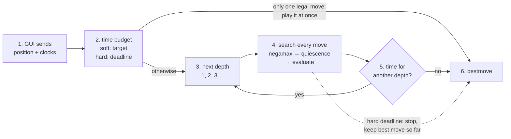
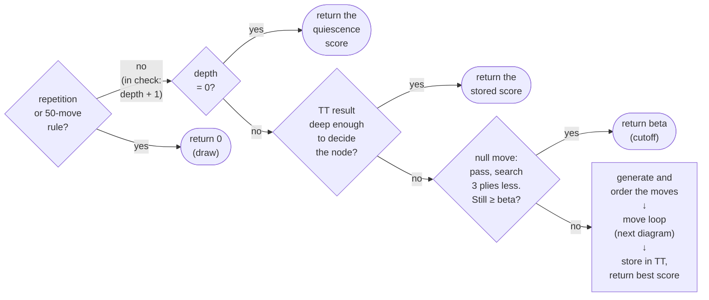
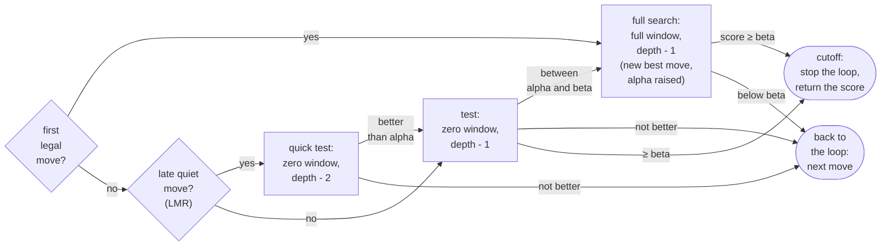

# Torrino

**A UCI chess engine written from scratch in C++17: bitboards, alpha-beta search with a transposition table and pruning, and a hand-crafted tapered evaluation, developed and measured version by version (≈ Stockfish `UCI_Elo` 2400 at 10+0.1).**


<!-- HERO GIF: must be the GIF of a whole GAME (animated), not of a single position.
     On the Lichess game page: "Share & export" -> GIF, or https://lichess1.org/game/export/gif/<GAME_ID>.gif
     Save it as docs/gifs/hero.gif (replacing the current image). -->
<p align="center"></p>

<p align="center">
Torrino plays bullet and blitz on Lichess as <a href="https://lichess.org/@/TorrinoBOT"><b>TorrinoBOT</b></a>
(bullet 2058, blitz 1897 on October 26, 2026).<br>
Every version is checked for correctness and measured in engine-vs-engine matches; the full log is in <a href="VERSIONS.md">VERSIONS.md</a>.
</p>

---

## Torrino in short

- **Written from scratch in C++17, no chess libraries:** bitboard board representation with magic bitboards for
  sliding pieces, legal move generation verified with perft.
- **Alpha-beta search:** negamax with iterative deepening, quiescence search, a transposition table, principal
  variation search, null-move pruning and late move reductions, plus move ordering by MVV-LVA and killer moves.
- **Hand-crafted evaluation:** material and piece-square tables blended between middlegame and endgame, king safety,
  pawn structure and endgame technique.
- **Measured, not guessed:** 13 versions, each tested in matches against the previous one and against Stockfish;
  every change and every result is logged in [VERSIONS.md](VERSIONS.md).

| | |
|---|---|
| **Strength** | about even with Stockfish limited to `UCI_Elo` 2400 at 10+0.1 (score 52% in 100 games: wins plus half the draws); 79.5% against `UCI_Elo` 2000 |
| **Search depth** | in 10+0.1 games, about 0.26 s per move: 8 plies on average in the middlegame, 9.6 in the endgame (10% of endgame moves reach 14 or more) |
| **Speed** | about 2.7 million positions per second on one laptop core; depth 7 in about 0.1 s per standard test position |
| **Online** | Lichess bullet 2058, blitz 1897 (October 26, 2026) |

---

## Table of contents

1. [Quick start](#quick-start)
2. [How the engine works](#how-the-engine-works)
   - [Board and move generation](#board-and-move-generation)
   - [Search](#search)
   - [Time management](#time-management)
   - [Evaluation](#evaluation)
3. [Version history](#version-history)
4. [Results](#results)
5. [Testing and validation](#testing-and-validation)
6. [Usage (UCI)](#usage-uci)
7. [Known weaknesses and next steps](#known-weaknesses-and-next-steps)
8. [What I learned](#what-i-learned)
9. [About](#about)
10. [References](#references)

---

## Quick start

```bash
git clone https://github.com/GiorgioPaoli/torrino.git
cd torrino/src
g++ -O3 -march=native -flto -static -std=c++17 *.cpp -o ../bin/torrino.exe
```
Requires a C++17 compiler (developed with g++ / MinGW-w64 on Windows). Then run `bin/torrino.exe` in any UCI
interface; the commands are listed in [Usage (UCI)](#usage-uci).
<!-- TODO: replace with a Makefile or CMakeLists.txt so the build is one command, and test it on a clean machine. -->

---

## How the engine works

From the moment the GUI sends a position to the moment the engine answers with a move:



1. **The GUI sends the position and the clocks** through the UCI protocol (`position ...`, then `go` with each
   side's remaining time and increment).
2. **The engine sets a time budget** for this move: a *soft* limit, the time it aims to use (a share of the remaining
   time plus the increment), and a *hard* limit, an absolute deadline it never exceeds. With a single legal move it
   answers at once.
3. **Iterative deepening.** Instead of one long search, it searches to depth 1, then 2, then 3, and so on. Each depth
   is cheap compared with the next one, and it gives two things: a best move is always ready if time runs out, and the
   best move of each depth is searched first at the next one, which makes the search much faster (see [Search](#search)).
4. **The search.** Every legal move at the root is searched with negamax (alpha-beta) down to the current depth; at the
   end of each line, quiescence search plays out the captures, and the evaluation scores the resulting position.
   The scores travel back up the tree, and the move with the best score becomes the current best move. The engine
   reports each completed depth to the GUI (`info depth ... score ... pv ...`).
5. **After each depth** it decides whether there is time for another one ([Time management](#time-management)). If the
   hard deadline arrives in the middle of a depth, the search stops at once and keeps the best move found so far.
6. **The engine answers** with `bestmove`.

### Board and move generation
The board is twelve 64-bit integers (**bitboards**), one per piece type and colour, plus a 64-square array. Bitboards
turn attacks and pawn structure into a few bitwise operations. Knight, king and pawn attacks come from precomputed
tables; bishop, rook and queen attacks from **magic bitboards**: the blocking pieces on a piece's lines are multiplied
by a precomputed "magic" number, and the result indexes a table that holds the attacked squares. Moves are generated
pseudo-legally and checked for legality after `makeMove`; `makeMove` / `unmakeMove` update the position and its
Zobrist key incrementally, without copying the board.

### Search
The core is **negamax with alpha-beta**: a move is only worth searching completely if it can change the result, so
whole branches are cut. The search keeps two bounds: **alpha**, the best score the side to move is already sure of,
and **beta**, the score above which the opponent would never allow this position (so searching further is useless).
The better the move ordering, the more is cut. Each node of the search goes through these steps:

<details>
<summary><b>Diagram: one negamax node</b> (click to open)</summary>



</details>

1. **Draws and extensions.** A repeated position or the fifty-move rule scores 0. When the side to move is in check,
   the node is searched one ply deeper, so checking sequences are not cut short.
2. **Quiescence at depth 0.** Instead of evaluating immediately, the engine keeps searching captures until the
   position is quiet, so it never evaluates in the middle of an exchange (the "horizon effect").
3. **Transposition table.** A table of 2^20 entries, indexed by the position's Zobrist key, stores the best move and
   the score of positions already searched. A stored result that is deep enough answers the node directly; otherwise
   its best move is searched first.
4. **Null-move pruning.** The side to move "passes" and the position is searched 3 plies shallower. If it is still at
   least beta, the real moves would be too, so the node returns beta at once. Not used in check or with only king and
   pawns (zugzwang, where passing would be better than any move).
5. **Move ordering.** The TT move first, then captures by MVV-LVA (most valuable victim, least valuable attacker),
   then killer moves (quiet moves that caused a cutoff at the same depth), then the rest, picked one at a time.
6. **The move loop**, below.

<details>
<summary><b>Diagram: one move in the loop</b> (click to open)</summary>



</details>

Every legal move goes through these gates, in the order chosen by the move ordering:
1. **The first legal move** gets a full search; its score becomes alpha.
2. **Every other move** is only tested with a **zero window** (alpha, alpha + 1): a search that can only answer
   "better than alpha or not", which is much cheaper than computing an exact score (principal variation search).
3. **Late quiet moves** (after the first three legal moves; not captures, killers or checks) are first tested one ply
   shallower (**late move reductions**). If one of them looks better than alpha, it is tested again at full depth.
4. **Only a move that is really better** gets the full search and becomes the new best move.
5. **A score of at least beta is a cutoff:** the opponent would avoid this position, so the remaining moves are
   skipped; a quiet move that causes it is remembered as a killer move.
6. **Otherwise the loop continues with the next move.** When no moves are left, the node returns its best score and
   stores it in the transposition table (last step of the previous diagram).

### Time management
`uci.cpp` turns the clock into two limits: a **soft** limit (the time the engine aims to use, a share of the remaining
time plus the increment) and a **hard** limit (a deadline, checked every 2048 nodes). After each completed depth the
engine stops if the soft limit is used up, continues if the next depth is predicted to fit before the deadline, and
also continues while it has used less than 30% of the soft limit, since an interrupted depth still improves the move.
A position with a single legal move is answered at once.

### Evaluation
The score is in centipawns (100 = one pawn), from the point of view of the side to move. It is computed with
middlegame and with endgame weights, and the two are blended by the game phase (from the remaining pieces):

- **Material and placement.** Pawn 100, knight 320, bishop 330, rook 500, queen 900, plus piece-square tables
  (central knights, advanced pawns, a sheltered king in the middlegame and an active king in the endgame).
- **Development** in the middlegame: penalties for minor pieces still at home and for an early queen move.
- **King safety** in the middlegame: castling, the pawn shield, a king walking up the board, and enemy pieces
  attacking the squares around the king (penalty growing with the square of the attack, so a coordinated attack
  weighs much more than a single piece).
- **Pawn structure:** passed pawns (bonus growing with the rank, larger in the endgame), isolated, doubled and
  defended pawns.
- **Mop-up** in won endgames: drive the losing king to the edge and bring the winning king closer, so basic mates are
  converted instead of drifting to a fifty-move draw.

Each group was added after finding the matching weakness in real games (v10). What the evaluation does not know yet is
listed in [Known weaknesses](#known-weaknesses-and-next-steps).

<details>
<summary><b>Source files</b></summary>

| Module | Files |
|---|---|
| Board, moves, Zobrist keys | [`board`](src/board.cpp), [`types.h`](src/types.h), [`bitboard.h`](src/bitboard.h), [`zobrist`](src/zobrist.cpp) |
| Attacks, magic bitboards | [`attacks`](src/attacks.cpp), [`magics`](src/magics.cpp) (numbers found by [`tools/find_magics.cpp`](tools/find_magics.cpp)) |
| Move generation and ordering | [`movegen`](src/movegen.cpp) |
| Search, transposition table | [`search`](src/search.cpp), [`tt`](src/tt.cpp) |
| Evaluation | [`eval`](src/eval.cpp) |
| UCI protocol, time limits | [`uci`](src/uci.cpp) |
| Testing and analysis | [`perft`](src/perft.cpp), [`tools/`](tools/) |
</details>

---

## Version history

The engine was built in small steps; each version is a tag in the repository. How much each one gained is in
[Results](#results), the full test logs in [VERSIONS.md](VERSIONS.md).

| Version | What it added | Area |
|---|---|---|
| v1-v3 | First working engine: board, move generation, basic search, alpha-beta, iterative deepening | search |
| v4 | Quiescence search, development in the evaluation, en passant fix | search |
| v5 | Killer moves | search |
| v6 | Check extension, mate scores | search |
| v7 | Zobrist hashing, repetition detection, fifty-move rule | search |
| v8-v9 | Soft and hard time limits, next-depth estimate, keeping interrupted depths | time |
| v10 | Tapered evaluation and mop-up, king safety, pawn structure | evaluation |
| v11 | Magic bitboards, captures-only quiescence, lazy move ordering | speed |
| v12 | Transposition table (move ordering, cutoffs, mate scores) | search |
| v13 | Principal variation search, null-move pruning, late move reductions; new time management | search, time |

---

## Results

All local tests: 100-game matches at 10+0.1 (10 seconds plus 0.1 per move) in cutechess, with balanced openings and
colours swapped, on one laptop (Intel i5, single thread per engine). The results of every match, benchmark and
Lichess period, version by version, are in [VERSIONS.md](VERSIONS.md).

How to read the numbers:
- **Score** = (wins + half the draws) / games. 50% means equal strength; 79.5% means the engine took 79.5 points
  out of 100 games.
- **Elo difference** is the score converted to a rating gap, given with its uncertainty: **+70 ± 64** means the
  measured difference is +70, and with 95% confidence the true one lies between +6 and +134. 100 games give an
  uncertainty of about ± 60-70 Elo, which is why small gains are not always significant.
- In the charts, the vertical lines on bars and points show that uncertainty range.

### Strength across versions

<!-- TODO: replace with the round-robin of all versions (one tournament, one Elo scale) when it is done. -->
<picture>
  <source media="(prefers-color-scheme: dark)" srcset="docs/images/elo_per_version_dark.png">
  
</picture>

Every version beat the previous one. The largest gains came from quiescence search (v4), the evaluation rework (v10),
the speed work (v11) and the transposition table (v12). Gains measured against the previous version cannot simply be
added up: self-play tends to exaggerate them, and the errors accumulate. The comparison with Stockfish below is the
external check.

### Against Stockfish

<picture>
  <source media="(prefers-color-scheme: dark)" srcset="docs/images/vs_stockfish_dark.png">
  
</picture>

Against the same opponent (Stockfish limited to `UCI_Elo` 2000) the score (wins plus half the draws) rose from 41% (v5) to 79.5% (v13). From v6
to v10 it stayed around 53-56%: those versions improved the evaluation and the time management, but limited
Stockfish loses mainly through tactical errors, which only a deeper search exploits. The transposition table and the
pruning (v12, v13) changed that. Against stronger levels v13 scores 52% against `UCI_Elo` 2400. At 10+0.1 these
levels are compressed (2200 and 2300 gave almost the same score), so they are a reference scale, not a rating.

### Search depth

<picture>
  <source media="(prefers-color-scheme: dark)" srcset="docs/images/depth_per_version_dark.png">
  
</picture>

Up to v11 the depth reached in games stayed between 5 and 5.5 plies, while the strength kept rising: those gains came
from searching better and evaluating better, not deeper. v10's richer evaluation even cost some depth. The
transposition table and the pruning then added about 2.4 plies at the same time per move. Data: about 210,000
engine moves from the match records in [`docs/matches`](docs/matches).

### Speed

<picture>
  <source media="(prefers-color-scheme: dark)" srcset="docs/images/speed_per_version_dark.png">
  
</picture>

Time to reach depth 7 on the 6 standard test positions. v4 is slower than v3 because quiescence search resolves every
capture sequence (and plays much better for it); v10 is slower because of its evaluation. v11 made every node faster
(magic bitboards), while v12 and v13 search far fewer nodes: their speed in nodes per second stays about the same, but
the same depth takes about 3 and then 15 times less time than with v11. Data in [`docs/data/bench_all_versions.csv`](docs/data/bench_all_versions.csv).

**Time usage.** In local matches the engine uses about 0.25 s per move at 10+0.1. On Lichess it used to finish 60+1
games with about 25 s left on the clock, time it could have spent searching; v13 changes the stop rule and spends a
larger share per move.

**Endgames.** v9 drew won endgames by the fifty-move rule (6 games a queen or a rook up in one match); with mop-up,
v10.1 mated in 11-14 moves in all test positions. With the transposition table and pruning the engine now also sees
the mate. With king and rook against king (`8/8/8/4k3/8/8/8/R3K3 w - - 0 1`), v11 stopped at depth 10
(66 million nodes, 7.6 s) without seeing a mate; v13 reports mate in 17 at depth 20 (49 million nodes, 9.2 s). With king and
queen against king (`8/8/8/4k3/8/8/8/3QK3 w - - 0 1`), v11 stopped at depth 7 (3.0 s) without a mate, v13 reports mate in 11 at
depth 15 (20 million nodes, 4.2 s).

### Lichess

<picture>
  <source media="(prefers-color-scheme: dark)" srcset="docs/images/lichess_rating_dark.png">
  
</picture>

Bullet rose from 1808 (v4) to 2058, blitz from 1689 to 1897 (October 26, 2026). Online ratings are noisy (changing
opponents, many of them bots with opening books, network lag) and complement the matches above without replacing them.
Torrino plays without an opening book.

---

## Testing and validation

| Check | Method | Status |
|---|---|---|
| Move generation | perft (count of all positions reachable at a given depth) on the 6 standard test positions, compared with the published values | all match |
| Zobrist keys | incremental key compared with the key recomputed from scratch at every perft node | pass |
| Magic bitboards | lookups compared with the old ray loops on 38.4 million random occupancies | 0 mismatches |
| Null move | hash and state checked after make / unmake at 177,905 positions | 0 errors |
| Repetition history | history balanced after every `unmakeMove`; 8 repetition test cases | pass |
| En passant edge cases | perft cross-checked against [python-chess](https://python-chess.readthedocs.io/) | pass |
| Evaluation | colour-mirrored positions must evaluate identically | checked on every change |
| Speed optimisations | identical node counts and best moves at fixed depth before and after | checked on every change |
| Strength | matches against the previous version and against Stockfish | every version |

The perft, magic bitboard and null move checks can be rerun with the programs in [`tools/tests/`](tools/tests/)
(build and run commands at the top of each file).

---

## Usage (UCI)

Torrino speaks UCI (Universal Chess Interface), so it works with any UCI GUI, such as cutechess, En Croissant or
Arena, and with [lichess-bot](https://github.com/lichess-bot-devs/lichess-bot).

Commands: `uci`, `isready`, `ucinewgame`, `position startpos | fen <fen> [moves ...]`,
`go depth N | movetime T | wtime W btime B [winc WI binc BI]`, `quit`, plus `eval` (static evaluation, for debugging).

```text
position startpos moves e2e4 e7e5
go depth 6
info depth 6 score cp 0 nodes 416341 nps 1764156 time 236 pv b1c3
bestmove b1c3
```

---

## Known weaknesses and next steps

The search is now fairly complete; most of what Torrino lacks is chess knowledge in the evaluation, which is
written and tuned by hand:
- **Piece activity and coordination:** no mobility term, no rooks on open files or on the 7th rank, no rook behind a
  passed pawn, no batteries, no bishop pair, no knight outposts.
- **Opening play:** without an opening book and without a notion of tempo, it sometimes develops a piece and moves it
  again several times (a bishop check that a pawn simply blocks).
- **Technical limits:** single thread, no endgame tablebases, time management tuned mainly for bullet.

**Next step: a learned evaluation.** The same search with a small neural network as the evaluation (NNUE-style),
trained on positions evaluated by Stockfish, to compare a hand-crafted and a learned evaluation under identical
conditions. After that: tuning the evaluation weights from data, and an opening book for online play.

---

## What I learned

I started Torrino for fun: I liked the idea of building my own chess engine from scratch, and of the moment when it
would beat me. Along the way it became a lesson in algorithms, performance and testing.

- **Writing fast code, step by step.** From bitboards and bitwise operations to magic bitboards, then to the
  transposition table with Zobrist hashing and the pruning inside negamax. What surprised me most were the gains of
  the search algorithms: the transposition table, null-move pruning and late move reductions together made depth 7
  about 25 times faster than v10. I find Zobrist hashing especially elegant: a whole position becomes one 64-bit
  number, updated with a few XORs per move.
- **Algorithms depend on each other.** The transposition table only works because of Zobrist keys; late move
  reductions and null-move pruning are only safe because the move ordering (helped by the transposition table) puts
  the best moves first. Adding a technique often meant understanding the ones it relies on.
- **Correctness comes before speed.** One mistake in `unmakeMove` is enough to break the whole engine. I learned to
  prove the code correct with perft, node counts and targeted tests before trusting any result.
- **Measure, don't guess.** Every version was checked with perft, speed and depth benchmarks, and above all a match
  against the previous version: I wanted proof that it was better. 100 games still leave a large uncertainty that
  only shrinks with more games; that was a compromise with the time I had. One result that changed how I think about
  engines: from v5 to v11 the search depth stayed around 5-5.5 plies while the strength kept rising, thanks to search
  quality (move ordering, quiescence, repetition handling) and the evaluation. v10 even searched less deep than v9
  and still won clearly.
- **Real games show what to fix.** I looked at the bot's games on Lichess to find its weaknesses: for example it could
  not win king and rook against king, so I knew what to work on next. The same happened with king safety and passed
  pawns.
- **Time management is a compromise.** v8 spent too much time in the middlegame and ended blitz games short of time;
  from v9 on the engine went the other way and finished 60+1 games with 20 seconds or more left.

**What I would do differently.** Pay more attention to how the bot actually plays, and experiment much more with the
piece-square tables, positional play and the evaluation as a whole, ideally tuning the weights automatically from
data instead of by hand. That is where the next step goes: a neural-network evaluation (NNUE-style), trained on
positions instead of written by hand (see [Known weaknesses and next steps](#known-weaknesses-and-next-steps)).

---

## About

I'm Giorgio Paoli, a third-year student of Computer and Control Engineering (Ingegneria Informatica e Automatica) at
Sapienza University of Rome. I started Torrino at the end of my second year, alongside my studies, and developed it up
to the current version (v13, October 26, 2026): about three months in total, two of which with the project on hold.

The testing and measurement tools in [`tools/`](tools/) were not written by me: the scripts that measure the engine
(search depth from the game records, speed and nodes per second, charts), the correctness tests in
[`tools/tests/`](tools/tests/) (perft, null move, magic bitboards) and the program that finds the magic numbers
for the magic bitboards ([`tools/find_magics.cpp`](tools/find_magics.cpp)) were written by an AI assistant (Claude),
which I also used as a tutor while learning the algorithms.

---

## References

**Algorithms** ([Chess Programming Wiki](https://www.chessprogramming.org/)):
[Bitboards](https://www.chessprogramming.org/Bitboards) ·
[Magic Bitboards](https://www.chessprogramming.org/Magic_Bitboards) ·
[Perft Results](https://www.chessprogramming.org/Perft_Results) ·
[Alpha-Beta](https://www.chessprogramming.org/Alpha-Beta) ·
[Iterative Deepening](https://www.chessprogramming.org/Iterative_Deepening) ·
[Quiescence Search](https://www.chessprogramming.org/Quiescence_Search) ·
[MVV-LVA](https://www.chessprogramming.org/MVV-LVA) ·
[Killer Heuristic](https://www.chessprogramming.org/Killer_Heuristic) ·
[Check Extensions](https://www.chessprogramming.org/Check_Extensions) ·
[Zobrist Hashing](https://www.chessprogramming.org/Zobrist_Hashing) ·
[Transposition Table](https://www.chessprogramming.org/Transposition_Table) ·
[Principal Variation Search](https://www.chessprogramming.org/Principal_Variation_Search) ·
[Null Move Pruning](https://www.chessprogramming.org/Null_Move_Pruning) ·
[Late Move Reductions](https://www.chessprogramming.org/Late_Move_Reductions) ·
[Tapered Eval](https://www.chessprogramming.org/Tapered_Eval) ·
[Time Management](https://www.chessprogramming.org/Time_Management)

**Time management discussions:**
[VeryChess 0.3.0 release](https://talkchess.com/viewtopic.php?p=995986) ·
[Time management and estimating search times](https://talkchess.com/viewtopic.php?p=894313) ·
[Easy moves and best-move stability](https://talkchess.com/viewtopic.php?p=402413) ·
[Crafty time.c](https://sources.debian.org/src/crafty/23.4-6/time.c/)

**Protocol and tools:**
[UCI protocol](https://www.shredderchess.com/chess-features/uci-universal-chess-interface.html) ·
[cutechess](https://github.com/cutechess/cutechess) (matches) ·
[lichess-bot](https://github.com/lichess-bot-devs/lichess-bot) (online play) ·
[Stockfish](https://stockfishchess.org/) (reference opponent and game analysis) ·
[python-chess](https://python-chess.readthedocs.io/) (cross-checks, analysis scripts) ·
[Mermaid](https://mermaid.js.org/) (diagrams)

## License and contact

License: [MIT](LICENSE) · Author: Giorgio Paoli · Contact: TODO
