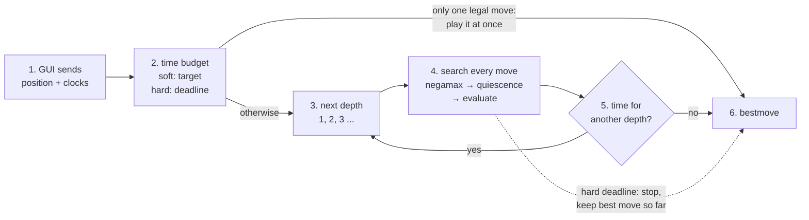
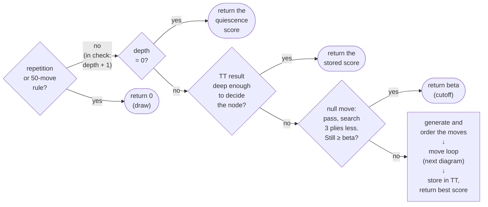
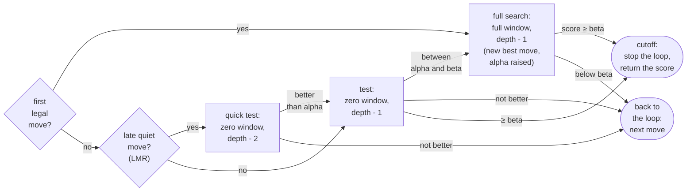

# How Torrino works

A detailed explanation of the engine: how a position becomes a move, what happens inside the search, how the time
is managed and how positions are evaluated. Back to the [README](../README.md) · measured results in
[VERSIONS.md](../VERSIONS.md).

## From position to move

From the moment the GUI sends a position to the moment the engine answers with a move:

1. **The GUI sends the position and the clocks** through the UCI protocol (`position ...`, then `go` with each
   side's remaining time and increment).
2. **The engine sets a time budget** for this move: a *soft* limit, the time it aims to use (a share of the remaining
   time plus the increment), and a *hard* limit, an absolute deadline it never exceeds. With a single legal move it
   answers at once.
3. **Iterative deepening.** Instead of one long search, it searches to depth 1, then 2, then 3, and so on. Each depth
   is cheap compared with the next one, and it gives two things: a best move is always ready if time runs out, and the
   best move of each depth is searched first at the next one, which makes the search much faster (see [Search](#search)).
4. **The search.** Every legal move at the root is searched with negamax (alpha-beta) down to the current depth; at the
   end of each line, quiescence search plays out the captures, and the evaluation scores the resulting position.
   The scores travel back up the tree, and the move with the best score becomes the current best move. The engine
   reports each completed depth to the GUI (`info depth ... score ... pv ...`).
5. **After each depth** it decides whether there is time for another one ([Time management](#time-management)). If the
   hard deadline arrives in the middle of a depth, the search stops at once and keeps the best move found so far.
6. **The engine answers** with `bestmove`.

## Board and move generation
The board is twelve 64-bit integers (**bitboards**), one per piece type and colour, plus a 64-square array. Bitboards
turn attacks and pawn structure into a few bitwise operations. Knight, king and pawn attacks come from precomputed
tables; bishop, rook and queen attacks from **magic bitboards**: the blocking pieces on a piece's lines are multiplied
by a precomputed "magic" number, and the result indexes a table that holds the attacked squares. Moves are generated
pseudo-legally and checked for legality after `makeMove`; `makeMove` / `unmakeMove` update the position and its
Zobrist key incrementally, without copying the board.

## Search
The core is **negamax with alpha-beta**: a move is only worth searching completely if it can change the result, so
whole branches are cut. The search keeps two bounds: **alpha**, the best score the side to move is already sure of,
and **beta**, the score above which the opponent would never allow this position (so searching further is useless).
The better the move ordering, the more is cut. Each node of the search goes through these steps:

**Diagram: one negamax node**

1. **Draws and extensions.** A repeated position or the fifty-move rule scores 0. When the side to move is in check,
   the node is searched one ply deeper, so checking sequences are not cut short.
2. **Quiescence at depth 0.** Instead of evaluating immediately, the engine keeps searching captures until the
   position is quiet, so it never evaluates in the middle of an exchange (the "horizon effect").
3. **Transposition table.** A table of 2^20 entries, indexed by the position's Zobrist key, stores the best move and
   the score of positions already searched. A stored result that is deep enough answers the node directly; otherwise
   its best move is searched first.
4. **Null-move pruning.** The side to move "passes" and the position is searched 3 plies shallower. If it is still at
   least beta, the real moves would be too, so the node returns beta at once. Not used in check or with only king and
   pawns (zugzwang, where passing would be better than any move).
5. **Move ordering.** The TT move first, then captures by MVV-LVA (most valuable victim, least valuable attacker),
   then killer moves (quiet moves that caused a cutoff at the same depth), then the rest, picked one at a time.
6. **The move loop**, below.

**Diagram: one move in the loop**

Every legal move goes through these gates, in the order chosen by the move ordering:
1. **The first legal move** gets a full search; its score becomes alpha.
2. **Every other move** is only tested with a **zero window** (alpha, alpha + 1): a search that can only answer
   "better than alpha or not", which is much cheaper than computing an exact score (principal variation search).
3. **Late quiet moves** (after the first three legal moves; not captures, killers or checks) are first tested one ply
   shallower (**late move reductions**). If one of them looks better than alpha, it is tested again at full depth.
4. **Only a move that is really better** gets the full search and becomes the new best move.
5. **A score of at least beta is a cutoff:** the opponent would avoid this position, so the remaining moves are
   skipped; a quiet move that causes it is remembered as a killer move.
6. **Otherwise the loop continues with the next move.** When no moves are left, the node returns its best score and
   stores it in the transposition table (last step of the previous diagram).

## Time management
`uci.cpp` turns the clock into two limits: a **soft** limit (the time the engine aims to use, a share of the remaining
time plus the increment) and a **hard** limit (a deadline, checked every 2048 nodes). After each completed depth the
engine stops if the soft limit is used up, continues if the next depth is predicted to fit before the deadline, and
also continues while it has used less than 30% of the soft limit, since an interrupted depth still improves the move.
A position with a single legal move is answered at once.

## Evaluation
The score is in centipawns (100 = one pawn), from the point of view of the side to move. It is computed with
middlegame and with endgame weights, and the two are blended by the game phase (from the remaining pieces):

- **Material and placement.** Pawn 100, knight 320, bishop 330, rook 500, queen 900, plus piece-square tables
  (central knights, advanced pawns, a sheltered king in the middlegame and an active king in the endgame).
- **Development** in the middlegame: penalties for minor pieces still at home and for an early queen move.
- **King safety** in the middlegame: castling, the pawn shield, a king walking up the board, and enemy pieces
  attacking the squares around the king (penalty growing with the square of the attack, so a coordinated attack
  weighs much more than a single piece).
- **Pawn structure:** passed pawns (bonus growing with the rank, larger in the endgame), isolated, doubled and
  defended pawns.
- **Mop-up** in won endgames: drive the losing king to the edge and bring the winning king closer, so basic mates are
  converted instead of drifting to a fifty-move draw.

Each group was added after finding the matching weakness in real games (v10). What the evaluation does not know yet is
listed in [Known weaknesses](../README.md#known-weaknesses-and-next-steps).

## Source files

| Module | Files |
|---|---|
| Board, moves, Zobrist keys | [`board`](../src/board.cpp), [`types.h`](../src/types.h), [`bitboard.h`](../src/bitboard.h), [`zobrist`](../src/zobrist.cpp) |
| Attacks, magic bitboards | [`attacks`](../src/attacks.cpp), [`magics`](../src/magics.cpp) (numbers found by [`tools/find_magics.cpp`](../tools/find_magics.cpp)) |
| Move generation and ordering | [`movegen`](../src/movegen.cpp) |
| Search, transposition table | [`search`](../src/search.cpp), [`tt`](../src/tt.cpp) |
| Evaluation | [`eval`](../src/eval.cpp) |
| UCI protocol, time limits | [`uci`](../src/uci.cpp) |
| Testing and analysis | [`perft`](../src/perft.cpp), [`tools/`](../tools/) |
